# Screenshots

## Live dashboard
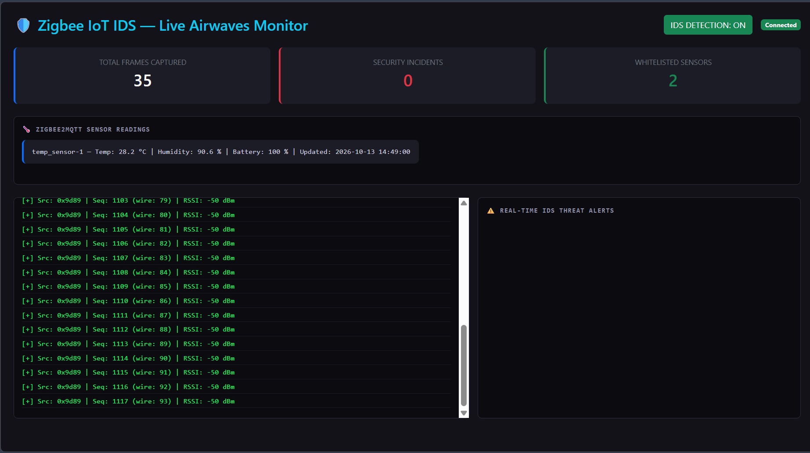
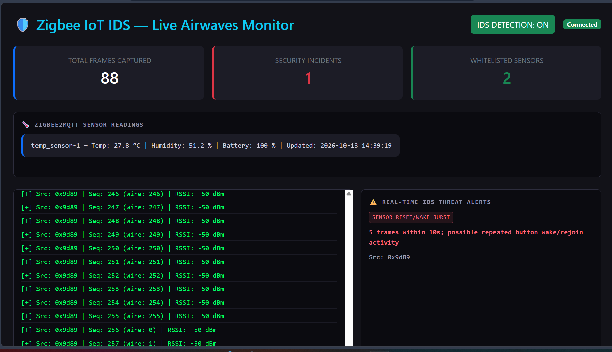
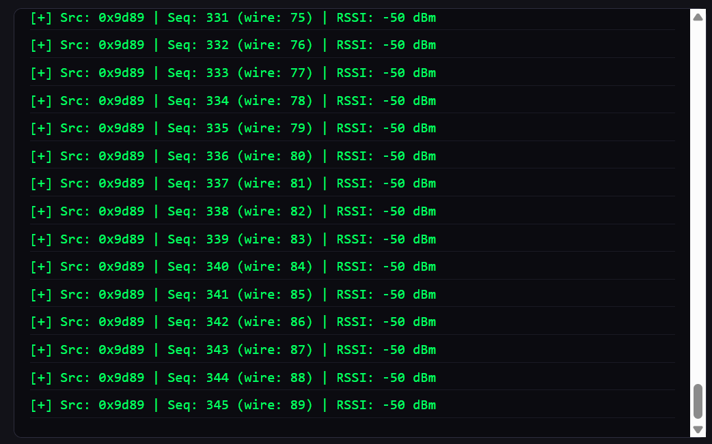

## Detection demo: off vs on
Each attack is run twice. With detection **off** it goes unnoticed, with detection **on** it is flagged.

### Replay attack
| Detection OFF | Detection ON |
|---|---|
| 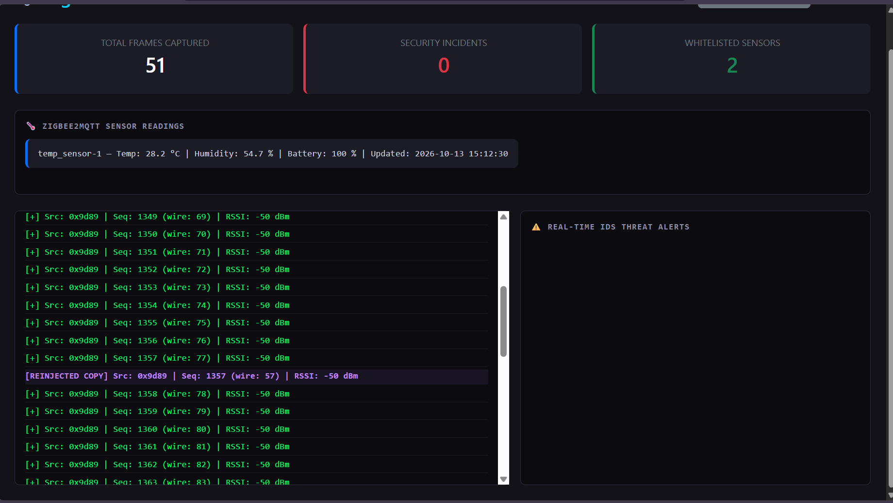 | 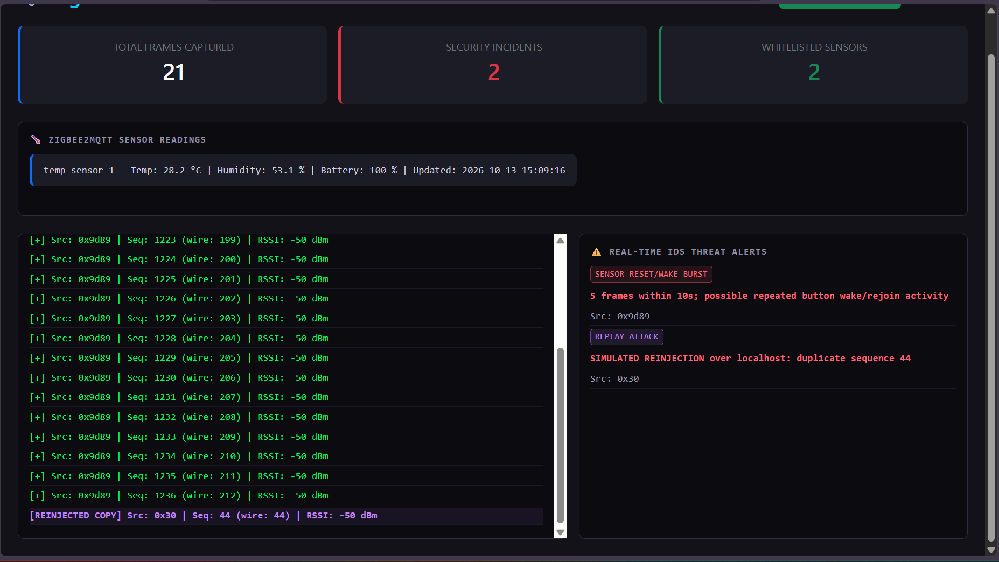 |

### Rogue device
| Detection OFF | Detection ON |
|---|---|
| 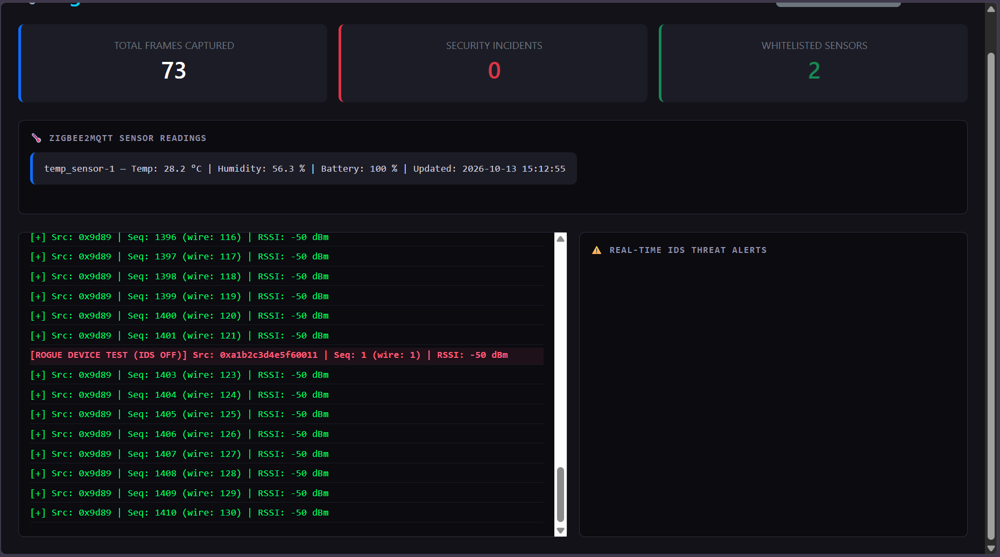 | 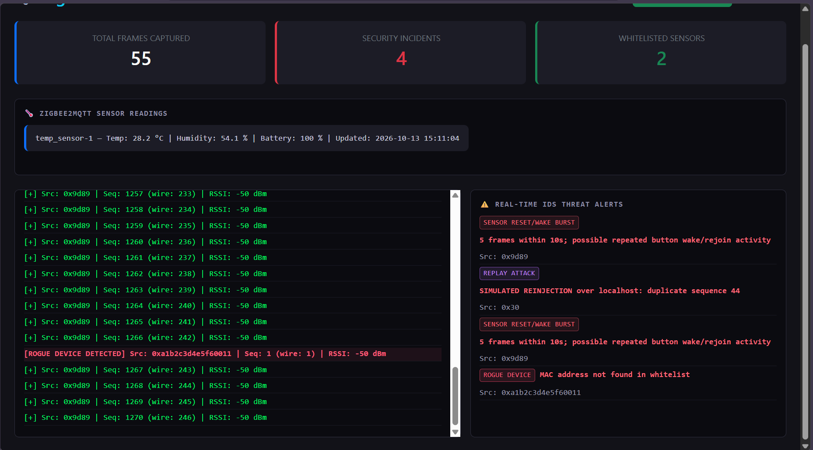 |

### Packet flooding
| Detection OFF | Detection ON |
|---|---|
| 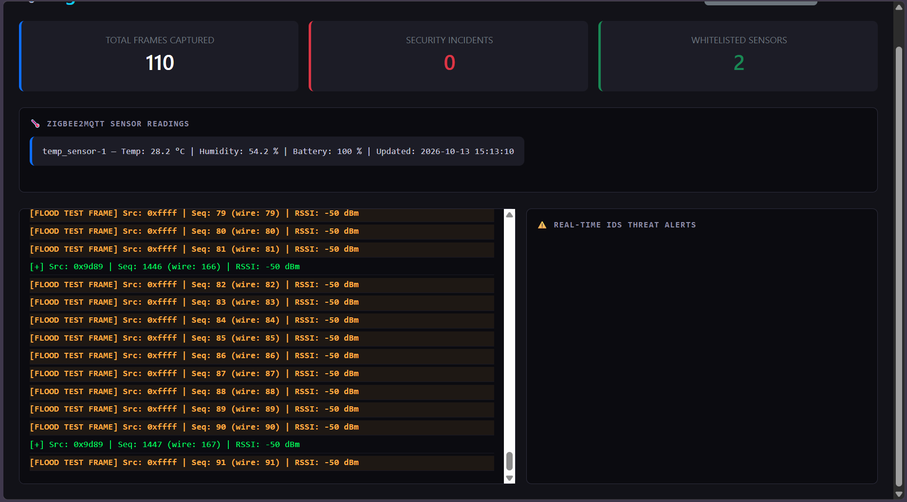 | 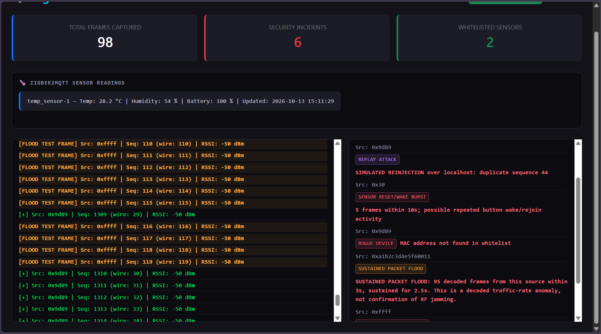 |

## Alerts
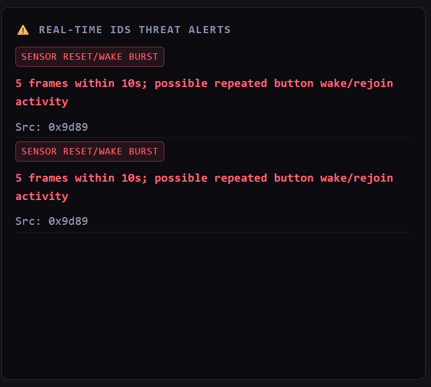

## Sniffer and packet capture
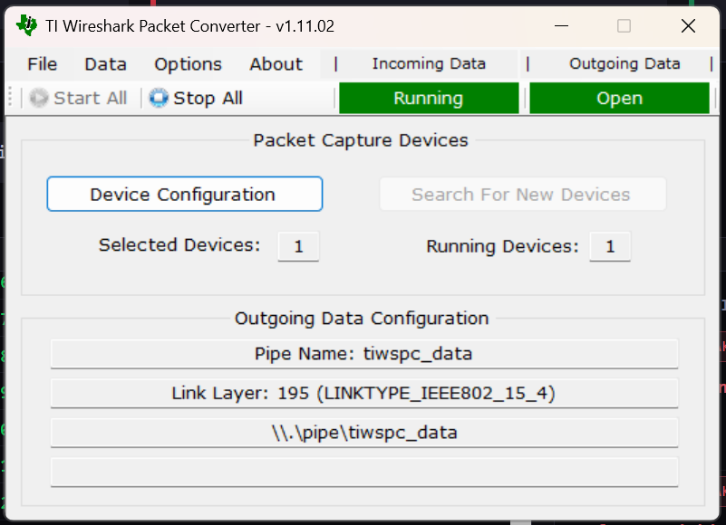
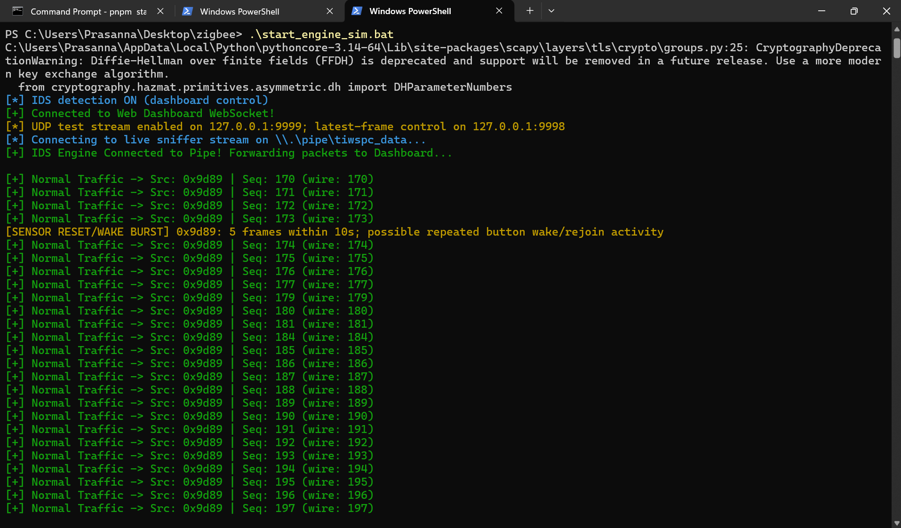

## Zigbee2MQTT setup
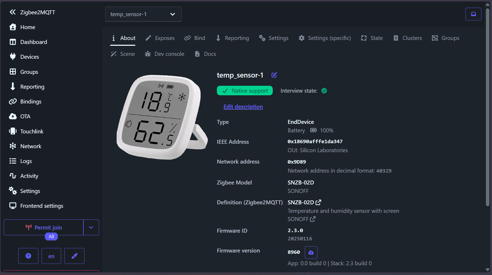
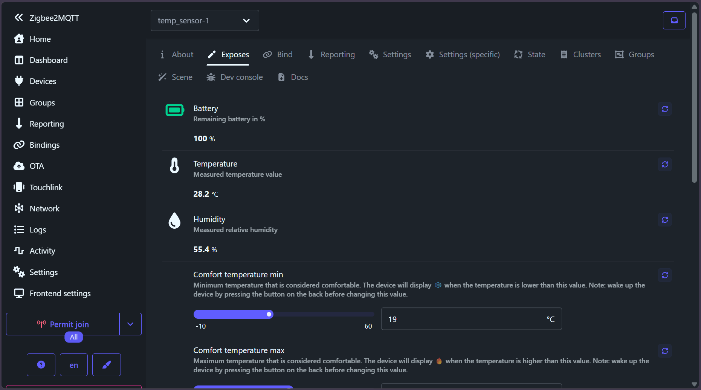
